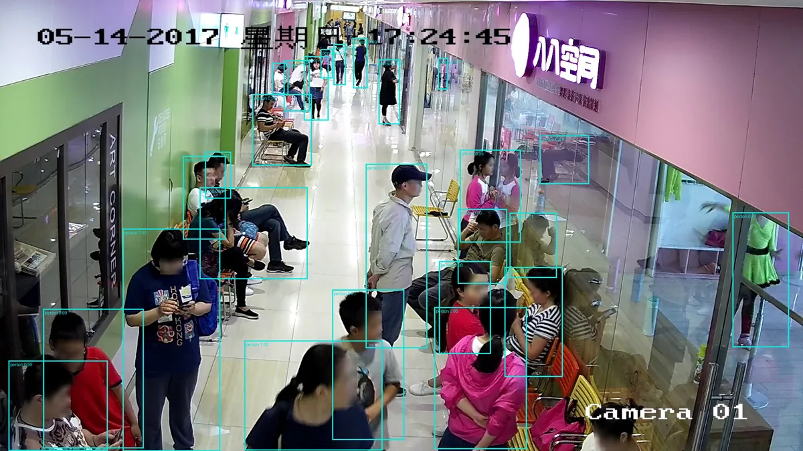

# crowd-detection

FasterRCNN 行人检测 Demo：COCO 预训练权重，只保留 `person` 类，阈值 0.6。

## 实测

| 图片 | 人数 | 平均置信度 | CPU 耗时 |
| --- | --- | --- | --- |
| 商场主通道 | 26 | 0.917 | 2,386 ms |
| 密集区域 | 24 | 0.849 | 2,151 ms |
| 远景 | 12 | 0.834 | 2,138 ms |



## 运行

```bash
pip install -r requirements.txt
python infer.py --images ./images --out results
```

首次运行会自动下载约 160 MB 的 COCO 权重。可用参数：`--threshold`、`--max`。

## 说明

- 单张 CPU 推理约 2.2 秒，不适合实时视频；GPU 预计 <100ms；
- 远处小目标和遮挡场景会漏检，阈值降到 0.4 能找回一部分，但误检增加；
- 结果图来自项目自带的测试画面，仅用于展示检测效果。
